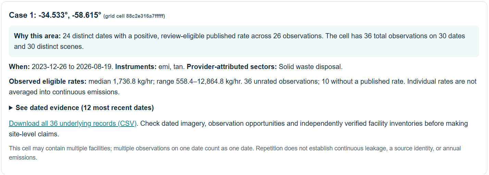
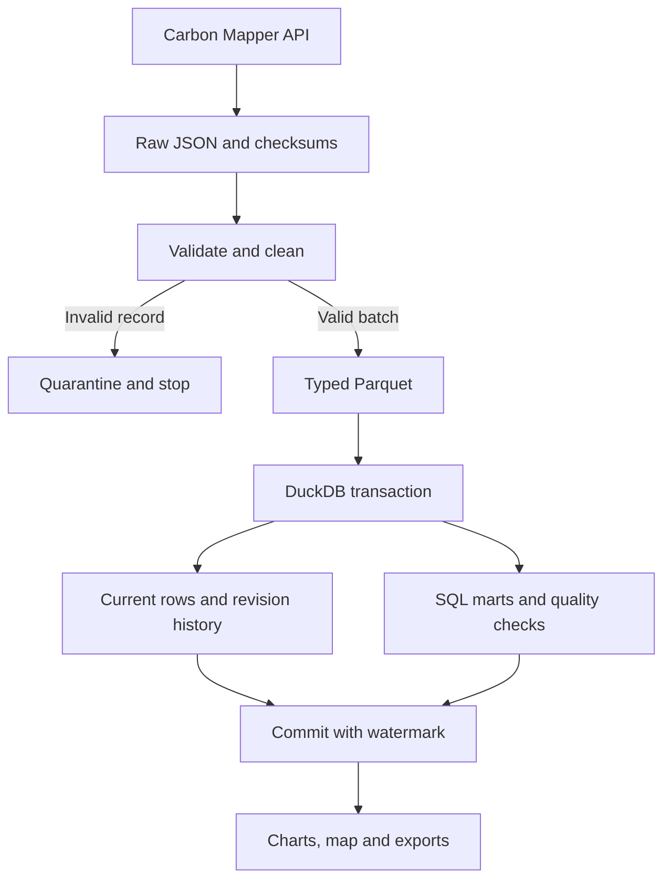

# Satellite Methane Investigation Pipeline

A Python pipeline for exploring published Carbon Mapper methane observations. It archives API responses, cleans them into Parquet, tracks revisions in DuckDB, and uses SQL and H3 to study observation patterns. Methane detection happens upstream; this project processes the published results.

The included historical snapshot has **21,329 EMIT/Tanager observations**, covering **August 10, 2022–October 6, 2026**. It is a selected satellite scope, not the entire Carbon Mapper catalogue. [Findings](docs/FINDINGS.md) · [Source attribution and terms](DATA_NOTICE.md)

## What this project found

Processed 21,329 published methane observations and identified
2,814 geographic grid cells with eligible observations on
multiple dates.

The pipeline produces five evidence-backed investigation cases.

For example, H3 cell 882cc56cbdfffff, near 37.927° N,
53.922° E, recorded 48 observations across 25 distinct dates,
including 18 dates with eligible emission-rate measurements.

This makes the area worth further investigation, but does
not prove a continuous leak or identify a specific facility.



[Read the detailed findings](docs/FINDINGS.md)

The generated report now leads with **up to five investigation case studies** rather than a crowded
map. Each case names an H3 cell and gives its exact observation dates, number of independent
scenes, instruments, provider-attributed sectors, available per-observation rate distribution,
and explicit caveats. It includes links to all underlying observation records.
The cases are prioritized **leads for human investigation**, not verified emitting facilities.
Run the pipeline to generate the current interactive report.The screenshot above previews the generated report; the interactive version can be reproduced locally.
## Run on Windows

Start Docker Desktop with Linux containers. Extract this ZIP, open the folder containing `compose.yaml`, and open PowerShell there. Run:

```powershell
docker compose run --build --rm pipeline
Start-Process .\reports\report.html
```

This builds one application image, replays the **complete archived dataset**, and creates the report plus CSV/Parquet exports in `reports\`.
Open `reports\report.html` and start with the **Evidence-backed investigation cases** section.
The corresponding evidence is available in `reports\investigations.json`,
`reports\investigation_summary.csv`, and `reports\investigations\case_*.csv`.
Run it again to check that the observation and version counts stay at 21,329. No Python installation, credentials, AWS account, or paid service is needed.

The setup fits a Windows 11 laptop with 16 GB RAM and a 6 GB WSL limit. The container is capped at 3 GB and two CPUs; DuckDB uses a 1 GB session limit. Database files persist in the `methane-data` Docker volume. Building images requires internet. Historical replay, tests and the self-contained maps/charts work offline afterward.

## Collect live data

Use a separate data directory so the included historical result remains reproducible:

```powershell
docker compose run --rm pipeline --root /data/live --output /reports/live run
Start-Process .\reports\live\report.html
```

The first run collects the full selected scope. Subsequent runs request changes by source modification time. After seven days, the same command performs a full reconciliation. These are manual batch runs; Docker Desktop must be running. Live retrieval requires internet and uses the [documented public API](https://api.carbonmapper.org/api/v1/docs).

For a smaller live scope, add `--config config/regional.json` before `run`. To change dates or geography, copy `config/global.json` to `config/local.json`, edit it, and pass `--config config/local.json`. `bbox` is `[west, south, east, north]`; date endpoints are inclusive UTC midnights. Different filters get separate databases. The original notebook remains under `notebooks/legacy/`.

## How it works



Nine focused modules keep the steps separate:

| File | Responsibility |
|---|---|
| `api.py` | Pagination, bounded retries, raw response archives and replay verification |
| `normalize.py` | Types, validation, missing-value flags, content hashes and H3 cells |
| `warehouse.py` | Parquet loading, revision updates and SQL transformations |
| `pipeline.py` | Batch ordering, transactions, quality gates and replay |
| `reporting.py` | CSV/Parquet exports, Plotly charts and the offline Folium map |
| `investigations.py` | Deterministic H3 candidate selection, per-date evidence and case data |
| `config.py`, `common.py`, `cli.py` | Dataset settings, file/lock helpers and the four commands |

The **watermark** is the start time of the last successful live collection. Each incremental request overlaps it by 48 hours. Pagination checks filtered counts, offsets and duplicate UUIDs; incomplete responses fail the batch. A failed download restarts from page zero on the next attempt.

Each UUID has one current observation. A content hash identifies distinct encountered revisions, ignoring expiring image signatures. Source modification time orders revisions; later capture time breaks ties. Older revisions remain in history without overwriting newer facts. Repeated runs create audit entries but do not duplicate facts or version hashes.

During a full run, missing known IDs are queried again without a modification cutoff. Only confirmed absence retires a current row; history stays. More than 25% pending withdrawals blocks the batch for inspection. Withdrawal means absence from the selected published scope, not that emissions stopped. Incremental requests alone cannot detect withdrawals.

Facts, versions, SQL marts, quality results and the checkpoint commit together. **DuckDB is the only checkpoint**. Raw-page references and manifest/Parquet hashes preserve provenance. Offline replay verifies archived checksums and requires a full baseline before contiguous deltas; it never advances the live watermark. Reports are derived after commit and can be regenerated. There is no exactly-once claim across HTTP, files and DuckDB.

## Commands and tables

```powershell
# Query the historical warehouse
docker compose run --rm pipeline query --sql "SELECT sector_name, observations FROM mart_sectors ORDER BY observations DESC"

# Inspect runs and quality checks
docker compose run --rm pipeline query --sql "SELECT mode, status, started_at, error FROM pipeline_runs ORDER BY started_at DESC LIMIT 5"
docker compose run --rm pipeline query --sql "SELECT * FROM quality_results ORDER BY run_id DESC LIMIT 11"

# Regenerate the historical report, or force live reconciliation
docker compose run --rm pipeline --output /reports report
docker compose run --rm pipeline --root /data/live --output /reports/live run --mode full
```

| Tables | Grain |
|---|---|
| `fact_observations` | One current provider UUID; timestamps, rate/uncertainty in kg/hr, quality flags, H3 cell and raw-page reference |
| `observation_versions`, `mart_revision_history` | UUID + content hash; the view compares encountered rates with `LAG` |
| `observation_state`, `retirements` | Last state per UUID; confirmed absence per run/UUID |
| `dim_platform`, `dim_sector`, `dim_date`, `dim_location` | Instrument/platform pair, sector code, UTC date, H3 cell |
| `mart_monthly`, `mart_sectors`, `mart_locations`, `mart_review_queue` | Month/instrument, sector, occupied H3 cell, eligible investigation cell |
| `pipeline_runs`, `quality_results`, `checkpoint` | Run, run/check, one checkpoint per dataset scope |

[SQL models](src/methane/sql/models.sql) · [Example analysis queries](src/methane/sql/analyses.sql)

## Tests and recovery

Build the test image, then run the suite with networking disabled:

```powershell
docker build --target test -t satellite-methane-test .
docker run --rm --network none --memory 3g satellite-methane-test
```

For Python development, install Python 3.12 and run these from the project folder:

```powershell
py -3.12 -m venv .venv
.\.venv\Scripts\python -m pip install -c requirements-lock.txt ".[dev]"
.\.venv\Scripts\python -m pytest -q
.\.venv\Scripts\python -m ruff check src tests
.\.venv\Scripts\python -m ruff format --check src tests
.\.venv\Scripts\python -m methane replay
```

The updated project passed 113 local automated tests,
Ruff linting and formatting checks, and GitHub Actions CI.

Historical replay processed 21,329 observations. A separate
live regional API run ingested 90 observations, followed
by a successful incremental run with no new or updated
records. Revision and withdrawal scenarios are covered
by automated tests.

Press **Ctrl+C** to interrupt a batch and rerun the same command to resume from committed state. The process lock releases when it exits. `docker compose down` keeps the data volume. Keep the database and its journal together.

| Problem | Next step |
|---|---|
| Docker cannot connect | Start Docker Desktop and check `docker info`. |
| Timeout, 429, 5xx or changing page count | Wait and rerun. Prior facts and watermark remain committed. |
| Invalid records or large withdrawal count | Inspect the failed run and its `quality/…/quarantine.json` inside the data volume before changing filters or thresholds. |
| Report/export fails | Fix disk space or permissions, then rerun `report`; ingestion has already committed. |
| Warehouse is lost or damaged | Replay into a fresh directory: `docker compose run --rm pipeline --root /data/rebuilt --output /reports/rebuilt replay --source /archives`. Keep any additional live archives if you need to reconstruct later updates. |

For the optional 42-observation California fixture:

```powershell
docker compose run --rm pipeline --config config/demo.json --output /reports/demo replay --source demo/archive
```

## Updating an existing GitHub checkout

The repository includes frozen historical inputs in `archives/` (about 36 MB), source manifests, SQL,
tests, configuration, and a GitHub Actions workflow. New downloads, databases, exports, local settings
and credentials are ignored. **Validate the report and tests locally before publishing this upgrade.**

For an already connected Git repository, extract the upgrade over your existing project folder,
keeping its `.git` directory. After rebuilding Docker and reviewing the new report, run:

```powershell
git status --short
git add -A
git diff --cached --check
git commit -m "Add evidence-backed methane investigation case studies"
git push origin main
```

For a fresh, unconnected folder, initialize it and add your remote first. The repository history is
not stored inside this ZIP.

If Git asks for an identity, copy your repository-local name and email from your Aircraft project.

## How to use the investigation results

Treat each case as a **follow-up lead**, not proof of a leaking facility:

1. Review the candidate's distinct *eligible* observation dates, rate values and quality flags.
2. Open its CSV to inspect individual UUIDs, sensor, scene, location, source-page reference and dates.
3. Compare the evidence with independent facility inventories, imagery and the number of usable satellite observations before making an attribution.

Candidate selection is deterministic: cells must have eligible observations on at least two distinct UTC dates;
rank by number of distinct eligible dates and then by largest eligible reported rate; keep candidates
at least 10 km apart by their cell centers to reduce redundant neighboring leads. No measured emission
rate is extrapolated across time. Case counts are not unique facility counts, detection probabilities,
or annual greenhouse-gas emissions. No observation-quality ratings were supplied for the archived
21,329-row snapshot, so findings are **provisional**.

If you change the source data, regenerate the report. The results, CSVs and case count will reflect
the current committed warehouse and may differ from the historical findings.
